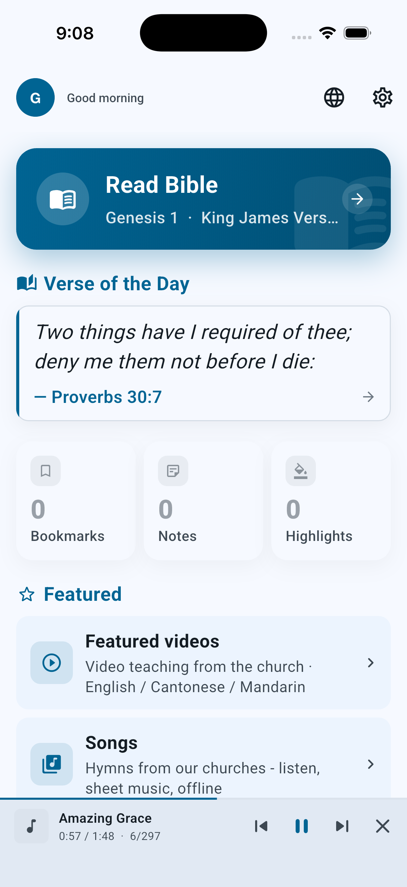
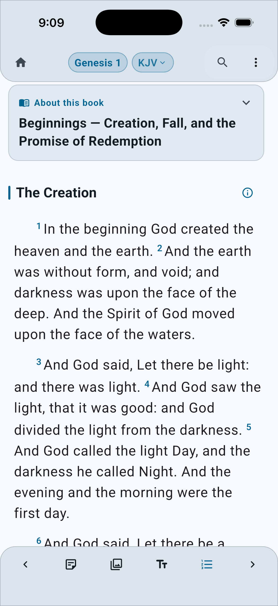
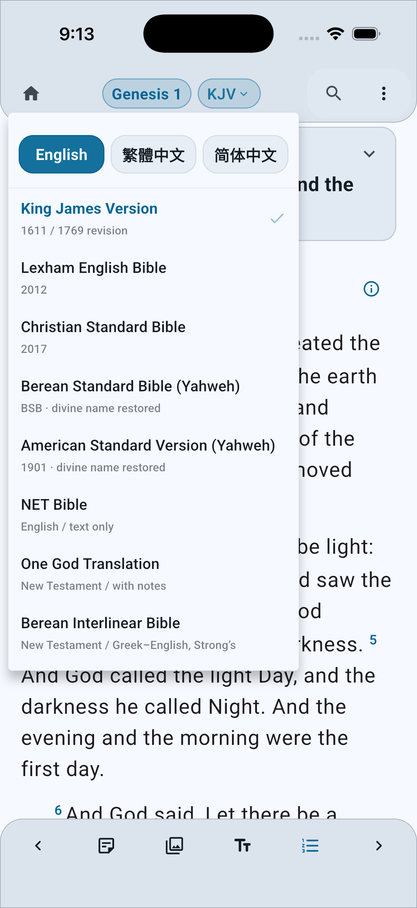
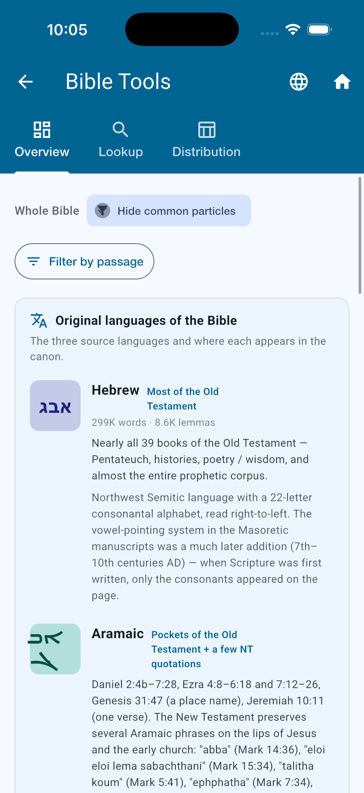
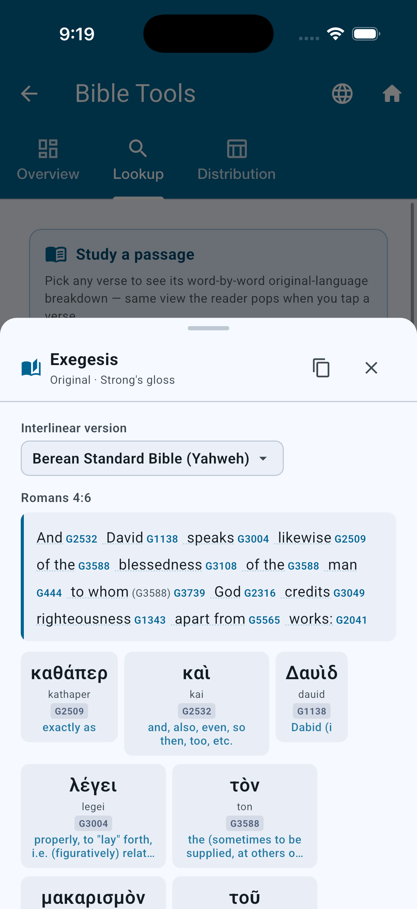
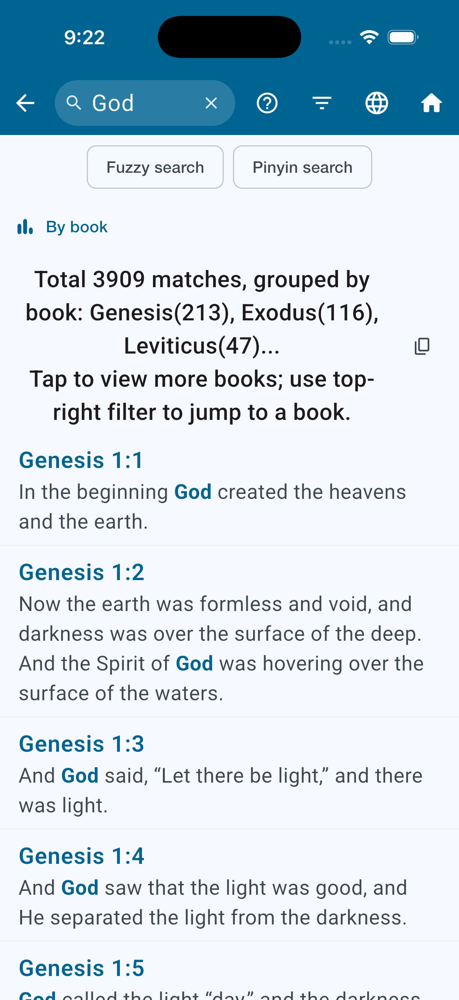
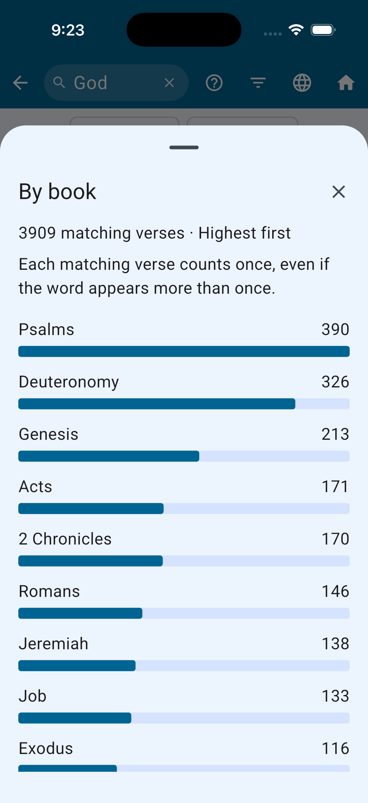
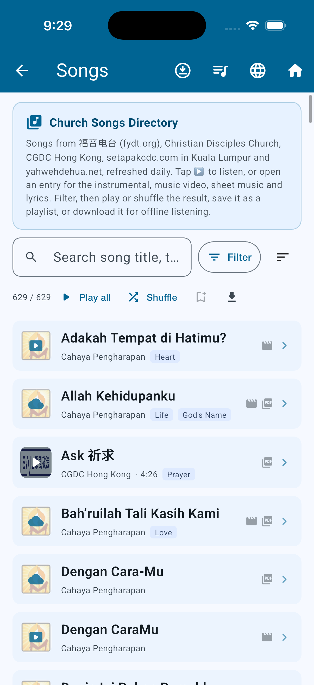
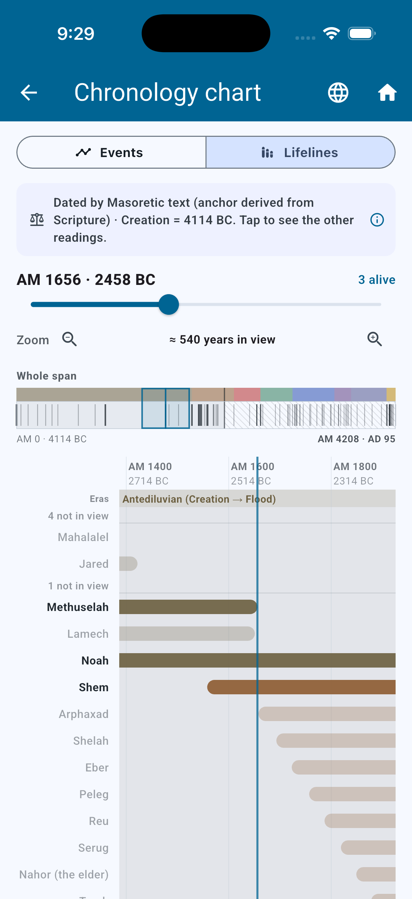
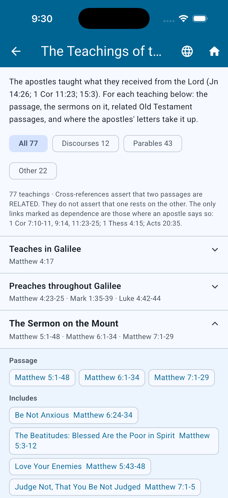

**Status, 2026-10-17.** The latest release is **1.7.32** (2026-10-17 — [release](https://github.com/SuyangLiuPaul/Yahwehs-Words/releases/latest)): [continuous vertical scrolling](#whats-new-since-173) and [Add-ons](docs/addon-modules.md) — importing Bible texts from MyBible.zone, MySword, theWord, Zefania XML, JSON and CSV. This file lags the code by design (see *Earlier additions* for what it last described in detail); when it disagrees with the tree, the tree wins.

<h1 align="center">Yahweh's Words · 雅伟之言</h1>

<p align="center">
  
</p>

<p align="center"><em>Study Yahweh's Words</em></p>

<p align="center">
  <a href="https://yahwehword.com">
    
  </a>
  <a href="https://github.com/SuyangLiuPaul/Yahwehs-Words/releases/latest">
    
  </a>
  
  
</p>

<!-- The repository is still named YsWords, so the github.com and
     shields.io URLs above must keep that spelling — they are addresses,
     not the name. Everything a reader SEES is "Yahweh's Words", which is
     what the app, the site, the manifest and the home-screen label all
     say. 2026-09-01. -->

---

## Current learning visibility

The Passion timetable is visible, with English, 简体中文 and 繁體中文 language switching, all 14 source-diagram placements and the attached original illustration. Bible principles and the new world-history wheel remain hidden from the Words dashboard at the owner’s request. Sermon resume navigation and the six Mandarin/Cantonese teaching videos remain available. Original page URLs are retained for compatibility. See [visibility and release notes](docs/release-visibility-1.7.1-2026-10-01.md).

## Try it now

🌐 **<https://yahwehword.com>** — opens in any modern browser. No install, no sign-in needed. Optional Google sign-in syncs highlights / bookmarks / notes / last-read position across devices.

📱 On mobile, tap your browser's menu → **Add to Home Screen** to install as a PWA — full offline reading after one tap of the *Offline Pack* in Settings.

---

## Quick start

### For users — nothing to install
Open <https://yahwehword.com> and start reading. Tap any verse to copy / highlight / bookmark / get an interlinear word study. The dashboard's quick-links grid puts Search, Library, Bible Tools, Bible Evidence, Sermons, Family Tree, Bible Timeline, Bible Trivia, **Feedback**, and Settings one tap away.

### For developers — clone, run, ship
```bash
git clone https://github.com/SuyangLiuPaul/Yahwehs-Words
cd YsWords
flutter pub get
flutter run -d chrome
```

To deploy to your own Netlify project:
```bash
flutter build web --release
netlify deploy --prod --dir=build/web --site=YOUR_SITE_ID
```

For cloud features (sync + AI + feedback email) to work in
production, see [**SETUP.md**](SETUP.md). The fastest path:

1. Open the deployed app → Settings → About → bottom →
   **"Run check"** diagnostic. It probes Firebase Auth, Realtime
   Database, and the AI proxy.
2. Any failing rows give one-click "Open Cloud Console" / "Open
   Firebase Console" / "Open Netlify env vars" deep-links straight
   to the page that fixes them.
3. The collapsible "One-time cloud setup walkthrough" right below
   the diagnostic explains each step with ⓘ details on why it
   matters and what breaks without it.
4. Optional: `bash scripts/enable-cloud-apis.sh` (or paste it into
   <https://shell.cloud.google.com>) auto-enables the Gemini API
   in one command.

The diagnostic + walkthrough live inside the app permanently —
once set up, you can ignore them. **End users never need to enable
any APIs themselves**; everything is at the Firebase project level.

---

## What's new since 1.7.3

**Ahead of the latest release (dev site, unreleased)**

- **Continuous vertical scrolling.** An optional reading mode — off by default — in which chapters flow into each other in both directions, with a chapter heading between them; the header, URL and position pill follow the chapter you are in. Switch: Settings, the reader's font sheet, the ⇅ button on the reader's bottom bar, or the ⋮ menu. Reading-plan days still page chapter by chapter. Also in Yahweh's Sword (its 阅读 mode).
- **Add-ons: import your own Bible text.** Settings › Add-ons. Reads **MyBible.zone** (`.SQLite3`), **MySword** (`.bbl.mybible`), **theWord** (`.ont` `.ot` `.nt`), **Zefania XML**, and our own **JSON** and **CSV**; recognises (and declines) commentaries and dictionaries; refuses e-Sword and anything its publisher locked. The file stays on the device — never uploaded, synced or shared — and the reader confirms they have the right to use it first. An import is marked **Your file**, sorts after the shipped editions, and is shown exactly as its file has it. A pure-Dart, read-only SQLite reader makes this identical on web, iOS, Android, macOS, Windows and Linux with no native library. [Specification, evidence and limits](docs/addon-modules.md) · [what only a real module can prove](docs/addons-manual-verification.md).

**Released**

| Version | Date | What |
| --- | --- | --- |
| 1.7.31 | 2026-10-16 | About without duplicate update controls (they live in Settings; About links to them); no interface string names the author |
| 1.7.30 | 2026-10-16 | Redesigned reading-plan pages and nicer empty states across the app; About states the purpose, quotes John 17:3 and notes the name *Yahweh* with its occurrence count; tables redesigned (word-distribution table with a pinned word column and heat shading, localised headers and thousands separators; book and lemma tables with zebra rows and bars) |
| 1.7.26 – 1.7.29 | 2026-10-15 – 16 | **Reading plans**: six verified plans including M'Cheyne 1842; several at once, with a start date, pause and catch-up, and per-plan reminders; a chapter counts as read when you scroll to its end; your own plan, days off, streak, bulk catch-up, read again, share, midnight refresh; the reader opened from a plan is limited to the day's chapters, with a back arrow and a progress bar; the home card appears only once a plan is started; plan data is in the offline pack |
| 1.7.25 | 2026-10-15 | English for the Bible-principles, promises and testaments pages |
| 1.7.17 – 1.7.24 | 2026-10-08 – 12 | Store delivery work (Microsoft, Apple, Google), Genesis display labels across the app, mini-player artwork decoding capped to its display size |
| 1.7.16 | 2026-10-08 | Basic and Advanced Settings on all platforms |
| 1.7.4 – 1.7.15 | 2026-10-02 – 07 | Phone-controlled Apple Watch / Wear OS / CarPlay / Android Auto companions; offline song and sermon downloads with progress, retry and delete; Chinese lexicon follows Eagle's View with edition-orthography footnotes (1.7.8); sermon and song playback crash fixes (1.7.9, 1.7.10); one tagline, *Study Yahweh's Words* (1.7.13) |

The per-version detail is the in-app **What's new** page (`assets/changelog.json`, generated from the commit history by `tools/build_changelog.py`).

### Earlier additions (1.7.0 – 1.7.3)

- Berean Interlinear NT word study with source Greek forms, English glosses, transliteration, Strong’s numbers and grammar. Greek-only reading editions stay hidden in Words at the owner’s request.
- Scoped search charts and mutually exclusive fuzzy / pinyin text search controls.
- Phone audio companions for Apple Watch and Wear OS, plus Android Auto media browsing. Apple approved CarPlay Audio; signed 1.7.2 beta builds are delivered, while public review and physical dashboard validation remain separate gates. [Build and distribution status](docs/car-and-watch.md).
- [Store and beta installation guide](https://yahwehword.com/beta#words), [release report](docs/release-2026-09-30.md), and [Eagle’s View review](docs/eaglesview-theology-review.md).
- Validation on 2026-09-30: analysis has no issues; **3,820 tests passed**, with 36 pre-existing skips.

## Features

| Category     | Details                                                                                                                 |
| ------------ | ----------------------------------------------------------------------------------------------------------------------- |
| Versions     | KJV · LEB · CSB · NET · Berean Standard Bible (Yahweh) · American Standard Version (Yahweh) · One God Translation (NT) · Berean Interlinear Bible (NT) · 和合本雅伟版 (简 / 繁) · 梁家铿译本 (简 / 繁) · 中文 NET (简 / 繁) — see [Bible Versions](#bible-versions) — **plus any text you import** ([Add-ons](docs/addon-modules.md)) |
| Reading      | Apple-glass reader controls; Light / Dark / System theme; Adjustable font family, size, line spacing, menu scale; Verse-by-verse or Paragraph Flow reading mode (default); **optional continuous vertical scrolling** (chapters flow into each other both ways); Full-width reading on all devices; Grid view default for new users; Reading mode toggle in header on tablet+ |
| Reading plans | Six verified plans (one-year Bible, M'Cheyne 1842, Paul's letters …) or your own, run several at once; start date, pause and catch-up, days off, per-plan daily reminders, streak; a chapter counts as read when you scroll to its end; the reader opened from a plan stays within the day's chapters |
| Add-ons      | Import a Bible text from MyBible.zone / MySword / theWord / Zefania XML / JSON / CSV — local-only, licence-confirmed, shown exactly as the file has it; commentaries and dictionaries recognised and declined for now ([details](docs/addon-modules.md)) |
| Highlights   | Mark verses with 6 colors (yellow, green, blue, pink, orange, purple); persistent across sessions                      |
| Bookmarks    | Bookmark + per-verse notes; visible inline indicator next to every flagged verse in both verse-by-verse and paragraph mode |
| Navigation   | Swipe left/right to change chapter; Floating chapter picker; Previous/next chapter buttons; Grid/List view for books with compact English/Chinese labels; Responsive grid for tablets/desktops; Collapsible sidebar for wide screens (≥600px) |
| Split View   | Two fully independent Bible panes; Side-by-side on tablet/desktop (≥600px) with draggable divider; Top-bottom on phone with draggable divider; Each pane has its own book, chapter, and version; Toggle in header |
| Search       | **Live search-as-you-type** with 250 ms debounce · Two explicit modes via chip strip: **Search** (text scan, also Enter default) and **AI** (Gemini-backed fuzzy/thematic, reference-only) · Direct-reference jump (`John 3:16`, `约 3:16`, `Rom 12:1-2`) · Strong's-# pattern (`G2316` / `H7200`) opens the lexicon page · Top-aligned **recent searches** with per-item delete · Bulk **Copy all results** to clipboard · Built-in **"?" help dialog** in your locale · Filter dropdown for whole-Bible vs current-book scope · Every keystroke resets to default scope (entire Bible) · **Tap a hit → smooth 350 ms scroll lands the verse 25 % from the top** with a bold `primaryContainer` wash + inline `►` arrow before the verse number in paragraph mode (auto-clears after 3.5 s) |
| Word Study   | Tap any verse → "Original" → word-by-word interlinear with Strong's, transliteration, gloss · Tap a chip → full lexicon entry, word family, synonyms, LXX cross-testament refs, concordance · **AI explanation** with adjustable scope: this verse / chapter / book / whole Bible / cross-testament / **deep exegesis (BDAG-level structured analysis)** — all reference-only · **Aramaic words highlighted** in Daniel 2:4-7:28, Ezra 4:8-6:18 + 7:12-26, Genesis 31:47, Jeremiah 10:11, plus NT transliterations (raca, talitha koum, abba, eloi, ephphatha, maranatha) · **Proper-noun complementary glosses** (English etymology + Chinese biblical identification side-by-side) |
| Annotations  | `{...}` inline badges with linked `<note:...>` pop-ups; `[...]` dotted-underline keywords; Book icon notes              |
| Section titles | Inline scripture-section headings with optional ⓘ context popovers — available by edition/book; NT-only editions retain their own scope                  |
| Book intros  | Collapsible historical-context card at the top of every chapter 1, bilingual                                            |
| Cross-refs   | Treasury of Scripture Knowledge (TSK) + OpenBible.info community votes — 29,319 source verses with their highest-voted to-references; surfaced via the cross-refs sheet on any selected verse |
| Bible Tools  | Originals overview · Strong's lookup · Word distribution table · Daily verse rotation (curated) · Languages card (Hebrew / Aramaic / Greek deep-dives with tappable passage links) |
| Bible Trivia | 68 curated entries on hidden patterns, acrostics, divine-name codes, numerical structures · Sorted by canonical Bible order · 4 schematic diagram types (Hebrew alphabet grid, chapter-counts bar chart, threefold sequence, numbered Hebrew words) for the most pattern-heavy entries |
| Bible Evidence | Browsable archive of 225 archaeology / manuscript / science / history finds with bilingual descriptions and scripture cross-link · **AI evidence search** (daily-rotating example queries based on today's evidence; Enter key submits — AI-generated, reference-only) · Chapter-aware filter from inside the reader |
| Cloud Sync   | Optional Google sign-in (from Settings → Account) syncs highlights + bookmarks + notes via Firebase Realtime Database (own-write echo guard + content-hash skip — no flicker, minimal traffic); offline-first with merge-then-overwrite reconciliation · **BYOK Gemini key real-time sync** across signed-in devices (paste on Device A → appears on Device B in seconds, no restart; clear on Device A → clears on Device B too) |
| Offline Pack | 5-category pre-fetch (Bibles 70 MB / Sermons 26 MB / Tools 10 MB / Originals 31 MB / Maps 29 MB) — full offline use after one-tap download |
| Reload       | One-tap Reload from the floating-header overflow menu and the empty-reader scaffold so users never have to relaunch the app to recover from a load failure |
| Copy & Share | Tap verses to multi-select; Copy in **Plain**, **With Reference**, or **Devotional** (default — flows as one continuous paragraph with the reference in parens at the end, 灵修 / 抄经 friendly) formats                            |
| Feedback     | In-app feedback form (Dashboard → **Feedback** tile) with category chips · Submitted server-side via Resend → developer's inbox · No tab switch · Auto-attached diagnostics (locale / Bible version / position / screen / theme / timezone / browser / IP) · Signed-in users get an opt-in "Send a copy to me" checkbox; guests can type their email · Falls back gracefully to `mailto:` if the email service is unconfigured |
| Persistence  | Last-read position, highlights & user settings stored with `shared_preferences`; cloud sync layered on top              |
| Platforms    | Android, iOS, Web, macOS, Windows, Linux                                                                                |

---

## Companion follow-up

Words 1.7.4 fixes unavailable song recordings, preserves the current queue/position during mix changes, and improves companion contrast and playback-state delivery. Google internal phone and Wear releases are available; public stores and physical pairing have separate gates. See [the current delivery record](docs/delivery-1.7.4-2026-10-02.md).

The 1.7.3 source update adds watch cover/title/progress presentation and the phone's currently selected Bible chapter, locale-aware car folders and a CarPlay return-to-library action. Google web reauthentication is verified through a separate same-origin helper without replacing the current user. Store deliveries and physical pairing checks are recorded separately in [the follow-up report](docs/release-authentication-1.7.3-2026-10-01.md).

## App screenshots

Ten distinct, unedited captures from the actual iOS simulator app, prepared on 1 October 2026. These are product previews; they do not indicate that a pending store review has approved the new build. Capture metadata and hashes are in [the screenshot manifest](docs/screenshots/2026-10-01/manifest.json).

<table>
<tr>
<td align="center"><a href="docs/screenshots/2026-10-01/iphone/01-home.png"></a><br/>Home and daily verse</td>
<td align="center"><a href="docs/screenshots/2026-10-01/iphone/02-reader.png"></a><br/>Bible reader</td>
<td align="center"><a href="docs/screenshots/2026-10-01/iphone/03-bible-editions.png"></a><br/>Bible editions</td>
</tr>
<tr>
<td align="center"><a href="docs/screenshots/2026-10-01/iphone/04-original-languages.png"></a><br/>Original languages</td>
<td align="center"><a href="docs/screenshots/2026-10-01/iphone/05-word-study.png"></a><br/>Word study</td>
<td align="center"><a href="docs/screenshots/2026-10-01/iphone/06-search-results.png"></a><br/>Search results</td>
</tr>
<tr>
<td align="center"><a href="docs/screenshots/2026-10-01/iphone/07-search-chart.png"></a><br/>Search chart</td>
<td align="center"><a href="docs/screenshots/2026-10-01/iphone/08-hymn-library.png"></a><br/>Hymn library</td>
<td align="center"><a href="docs/screenshots/2026-10-01/iphone/09-chronology.png"></a><br/>Bible chronology</td>
</tr>
<tr>
<td align="center"><a href="docs/screenshots/2026-10-01/iphone/10-teachings.png"></a><br/>Teachings of Jesus</td>
</tr>
</table>

Words has phone-controlled car and watch companions. Companion screenshots and physical-device validation are tracked separately in [car and watch delivery notes](docs/car-and-watch.md).

---

## Installation

```bash
# 1. Clone the repository
git clone https://github.com/SuyangLiuPaul/Yahwehs-Words.git
cd YsWords

# 2. Install Flutter dependencies
flutter pub get

# 3. Run (choose one)
flutter run                    # Debug on default device
flutter run -d chrome          # Debug in browser
flutter build apk --release    # Release APK
```

Requires **Flutter >= 3.22** and **Dart >= 3.2** (active dev/prod builds run on Flutter 3.44.2 / Dart 3.12; the SDK constraint in `pubspec.yaml` is `'>=3.2.3 <4.0.0'`). On Flutter 3.44 the iOS/macOS builds stay on CocoaPods — run `flutter config --no-enable-swift-package-manager` once per machine (the SPM-resolved Firebase SDK is incompatible with the pinned `cloud_firestore`).

---

## Live Web Demo

A production build is hosted on Netlify:

```
https://yahwehword.com/
```

The `yswords*.netlify.app` hostnames are the Netlify site names underneath
and still answer 200, but every one of them carries
`<link rel="canonical" href="https://yahwehword.com/">` — so linking to
them points readers and crawlers at a page that disowns itself. Use the
domain.

- Open in any modern browser (Chrome, Edge, Safari, Firefox).
- All Bible data is bundled — no download required on first load.
- On mobile, tap the browser menu -> "Add to Home Screen" to install as a PWA.

---

## Architecture at a glance

```
┌────────────────────────────┐     POST /api/aiSearch
│ Flutter Web app            ├────────────────────────┐
│ (Provider + Get + Material)│     POST /api/aiBibleSearch
│                            │     POST /api/aiExplainWord
│ Bible JSON in assets/      │     POST /api/submitFeedback
│ Strong's lexicon in assets │                        │
│ Local storage:             │                        ▼
│   shared_preferences       │              ┌──────────────────────┐
└─────┬───────────┬──────────┘              │ Netlify Functions    │
      │           │                          │ (serverless mjs)     │
      │ Google    │ Highlights/notes         └────┬───────┬─────────┘
      │ sign-in   │ via WebSocket                 │       │
      ▼           ▼                               │       │
┌──────────┐  ┌────────────────┐                  │       │
│ Firebase │  │ Firebase RTDB  │                  ▼       ▼
│ Auth     │  │ users/{uid}/   │       ┌───────────┐  ┌─────────────┐
└──────────┘  │ sync           │       │ Gemini    │  │ Resend      │
              └────────────────┘       │ (AI text) │  │ (feedback   │
                                       └───────────┘  │  emails)    │
                                                      └─────────────┘
```

The app itself has zero backend — it's a static Flutter web build
served by Netlify. The four `.mjs` Netlify Functions are the only
server-side code, each ≤200 lines. Every function returns 503 +
falls back gracefully when its env vars aren't set, so partial
deploys keep the offline parts of the app working.

---

## Project Structure

```
assets/                       Bible JSONs, Strong's lexicons, fonts, images,
                              maps, sermons, screenshots
docs/                         Setup notes (drive-sync, google-signin, etc.)
lib/
  main.dart                   App entry: Provider scope, GetMaterialApp,
                              theme, bootstrap (FetchVerses + auth init).
  models/                     Verse, Book, AppSettings, Strong's,
                              ReadingPlan, Sermon.
  providers/                  MainProvider (verses, current position,
                              highlights, bookmarks, notes).
  pages/                      DashboardPage, HomePage (reader), SearchPage,
                              SettingsPage, LibraryPage, HighlightsPage,
                              FeedbackPage, SermonsPage, EvidencePage,
                              FamilyTreePage, BibleTimelinePage, etc.
  widgets/                    BibleReadingPane, OriginalsSheet,
                              SetupInstructionsCard, CloudSetupDiagnostic,
                              GreetingCard, GoogleGLogo, etc.
  services/                   addons/ (store, registry, import service),
                              ReadingPlanService, Cloud (CloudAuthService,
                              RealtimeDbSyncService), AI proxy clients
                              (AiSearchService, AiBibleSearchService,
                              FeedbackService, ProfileService),
                              StrongsService, FetchVerses, FetchBooks,
                              ConcordanceService, browser-info /
                              link-opener / share-service stubs.
  constants/                  Book lists, UI strings (trilingual),
                              text patterns, Bible versions metadata.
  utils/                      Clipboard helper, search formatter,
                              version mapper, verse span builder,
                              responsive breakpoints, jump-to-reference,
                              short-book-name.
    addons/                   The Add-ons importer's pure-Dart half: SQLite
                              reader, MyBible / MySword / theWord / Zefania /
                              CSV / JSON parsers, markup normaliser, canon fit.
                              Identical in Yahweh's Sword; see docs/addon-modules.md.
netlify/
  functions/                  Server-side serverless functions:
                                aiSearch.mjs (Bible-evidence AI search)
                                aiBibleSearch.mjs (verse-ref AI search)
                                aiExplainWord.mjs (lexicon AI gloss)
                                submitFeedback.mjs (feedback → Resend)
  netlify.toml                Build config + redirects + cache headers
scripts/
  enable-cloud-apis.sh        One-shot Gemini API enabler for the Cloud
                              project that owns the OAuth client.
pubspec.yaml                  Flutter / Dart dependencies + asset
                              registration.
```

---

## Key Packages

| Package                        | Purpose                                   |
| ------------------------------ | ----------------------------------------- |
| `provider`                     | State management                          |
| `get`                          | Navigation via GetX                       |
| `scrollable_positioned_list`   | Precise verse scrolling and jump-to-index |
| `scroll_to_index`              | Auto-scroll in BooksPage                  |
| `shared_preferences`           | Persist settings & last position          |
| `file_selector`                | The Add-ons file chooser (web, iOS, Android, macOS, Windows, Linux) |
| `path_provider`                | Where native add-ons are stored (app-support directory) |
| `web`                          | IndexedDB for add-ons on the web, and other browser APIs |
| `crypto`                       | A short SHA-256 of an imported file, as provenance |

The full list, with the reason for each, is in `pubspec.yaml` — which comments every dependency.

---

## Data Sources

| Language | Version                    | Source                                             |
| -------- | -------------------------- | -------------------------------------------------- |
| English  | KJV, LEB                   | Public domain / Logos Bible Software               |
| English  | NASB 2020                  | Bundled at `assets/nasb.json` (text licensed)      |
| Chinese  | 梁家铿译本 (BIBLEXG v2)     | https://www.biblexg.com/                           |
| Chinese  | 和合本雅伟版                | https://yahwehdehua.net/cn                         |

All JSON files in `/assets/` are used with permission or where public-domain applies.

---

## JSON Verse Schema

Each verse record:

```json
{
  "book": "Genesis",
  "chapter": "1",
  "verse": "1",
  "text": "In the beginning God created the heavens and the earth.",
  "id": "001001001",
  "isParagraphStart": true
}
```

### Inline Tag Grammar

| Pattern | Rendered As |
| ------- | ----------- |
| `{text}` | Tappable colored badge annotation |
| `[text]` | Dotted-underline keyword |
| `<note:text>` | Book icon, tap to show note dialog |

Per-verse fields beyond `text`, all optional:

| Field | Meaning |
| --- | --- |
| `isParagraphStart` | the verse opens a paragraph |
| `paragraphType` | `inline` (default), `paragraph`, or `reference` (a quotation set as lines — internal `\n` are kept) |
| `blockNotes` | block-level editorial footnotes, rendered as an indented block below the verse |
| `superscription` | a psalm title printed above verse 1 (not a verse: no number, no id) |
| `verseLabel` | the printed verse label when it differs from `verse` (e.g. `34a`) |
| `subVerseOrder` | reading order among verses that share a `verse` number |

The `id` in the example above is carried by the bundled assets but is not read by the app (`Verse.fromJson` ignores it; a verse's identity is its English book name, chapter and label). `[text]` prints its brackets only for the editions in `kBracketPreservingVersions`; elsewhere the word is styled, not bracketed. Chapter/verse may be stored as strings or integers depending on source. An imported edition's text is normalised to exactly four things — plain text, `[added words]`, `<note: …>` and `\n` — by `lib/utils/addons/markup_normaliser.dart` ([why](docs/addon-modules.md#what-it-does-to-the-text)).

---

## Bible Versions

Generated by reading `lib/constants/bible_versions.dart` on 2026-10-17 (it is the source of truth; `pubspec.yaml`'s asset list is the second — an edition has to be declared there to ship at all). 20 catalogue rows, 14 visible:

| Key | Name | Language | Asset |
| --- | ---- | -------- | ----- |
| `kjv` | King James Version (1611 / 1769 revision) | English | `assets/kjv.json` |
| `leb` | Lexham English Bible (2012) | English | `assets/leb.json` |
| `csb` | Christian Standard Bible (2017) | English | `assets/csb.json` |
| `net` | NET Bible (text only) | English | `assets/net.json` |
| `bsb-yhwh` | Berean Standard Bible (Yahweh) — divine name restored | English | `assets/bsb-yhwh.json` |
| `asv-yhwh` | American Standard Version 1901 (Yahweh) — divine name restored | English | `assets/asv-yhwh.json` |
| `ogt` | One God Translation (New Testament, with notes) | English | `assets/ogt.json` |
| `bib` | Berean Interlinear Bible (New Testament; Greek–English, Strong's) | English | `assets/bib.json` |
| `cuvs-yhwh` | 和合本雅伟版 (简体) | Simplified Chinese | `assets/cuvs-yhwh.json` |
| `cuvs-yhwh-tr` | 和合本雅偉版 (繁體) | Traditional Chinese | `assets/cuvs-yhwh-tr.json` |
| `biblexg-v3` | 梁家铿译本 (简体, New Testament) | Simplified Chinese | `assets/biblexg-v3.json` |
| `biblexg-v3-tr` | 梁家鏗譯本 (繁體, New Testament) | Traditional Chinese | `assets/biblexg-v3-tr.json` |
| `cnet` | 中文 NET (简体, with translators' notes) | Simplified Chinese | `assets/cnet.json` |
| `cnet-tr` | 中文 NET (繁體, with translators' notes) | Traditional Chinese | `assets/cnet-tr.json` |
| `user-…` | **Your file** — any text imported through Add-ons | any | the device's own store, never the bundle |

**In the catalogue but hidden** (`disabledVersions`): `nasb`, `wh` (Westcott–Hort Greek NT), `lxx` (Septuagint), `sblgnt`, and the superseded `biblexg-v2` / `biblexg-v2-tr` (a stored preference for one of these resolves to its named successor or, failing that, to the first edition of the same language). On the web build NASB's asset is additionally stripped from the bundle.

**Default on first launch follows the interface language:** 简体 → `cuvs-yhwh`, 繁體 → `cuvs-yhwh-tr`, English → the first available English edition (`kjv`; NASB is the stated preference but is hidden).

<!-- 2026-10-17: rewritten from the catalogue. The previous table listed seven
     editions, three of them (nasb, biblexg-v2, biblexg-v2-tr) hidden, and
     stated a default that is no longer true. It had a note warning that it had
     drifted a month; it had drifted again — check
     lib/constants/bible_versions.dart before trusting any list in prose docs. -->

**Paragraph mode note**: Paragraph metadata is shared at load time. The NT uses LJK2 (`biblexg-v2`) as the canonical source; the OT uses `assets/web-ot-paragraphs.json`, a derived map of 11,922 verse starts from the public-domain World English Bible USFM. `FetchVerses` replays both sources by english book name + `chapter:verse`, so paragraph layout is consistent across translations wherever the version includes those verses.

---

## Build & Deploy

```bash
# Build for web
flutter build web

# Build for Android
flutter build apk --release
```

### Deploy to Netlify (manual)

GitHub and Netlify are NOT linked. Deployment is manual:

```bash
# 1. Build locally
flutter build web

# 2. Deploy to Netlify
netlify deploy --prod --dir=build/web --auth $NETLIFY_AUTH_TOKEN --site $NETLIFY_SITE_ID

# 3. Push to GitHub (uses GITHUB_TOKEN from .env when configured)
git push origin main
```

- **Live site**: https://yahwehword.com (Netlify site name `yswords`)
- **Publish directory**: `build/web/`
- **SPA redirect**: configured in `netlify.toml`

Netlify does NOT run Flutter — the build must be done locally first.

---

## Contributing

1. Fork this repo and clone your fork.
2. Create a feature branch: `git checkout -b feature/my-improvement`
3. Commit your changes with clear messages.
4. Push and open a Pull Request.

Please run `flutter analyze` before committing.

---

## Developer Environment

| Tool      | Version           |
| --------- | ----------------- |
| Flutter   | 3.22+             |
| Dart      | 3.2+              |
| IDEs      | VS Code, Android Studio |
| Analyzer  | `flutter analyze` |

---

## Disclaimer & Use

Yahweh's Words is a **non-commercial personal / community Bible-study tool**.
The application code is open source, but **scripture texts and other
embedded resources remain the copyright of their respective rights
holders**. They are reproduced here under fair-use / personal-study
exemptions and the explicit licences listed below.

This project is **not affiliated with or endorsed by** any of the
publishers, ministries, or font foundries referenced. The bundled
asset files are subject to their own licences which take precedence
over the MIT licence on the application code.

If you are a rights holder and have any concern about content
included here, please contact me at the address below — I commit to
responding and, where appropriate, removing the content within
**72 hours**.

---

## License

The **application code** in this repository is released under the
[MIT License](LICENSE). The **bundled scripture texts and other
asset files** are licensed separately as listed below.

### Bundled scripture texts

| Edition | Status | Notes |
| --- | --- | --- |
| KJV (1611 / 1769) | Public domain | No restrictions in most jurisdictions. |
| LEB (Lexham English Bible) | © Logos Bible Software | Used under the LEB licence; non-commercial study only. |
| NASB 2020 | © The Lockman Foundation | Used under the publisher's free-quotation provisions; non-commercial use only. |
| 和合本雅伟版 (CUVS-YHWH, 简/繁) | Used with permission | © Yahweh De Hua Ministry · https://yahwehdehua.net/cn |
| 梁家铿/梁家鏗译本 (BIBLEXG v2, 简/繁) | Used with permission | © Bible Exegesis Ministry · https://www.biblexg.com/ |

<!-- 2026-09-01: dropped 和合本 1919 (CUV) and 新译本 (CNV) — both
     DELETED outright in v1.4.5 (2026-08-03), assets and all, per
     HANDOFF.md's "Bible-version cleanup" entry. Neither text ships in
     this repo any more, so a license row for it is a claim about
     something not present. The BIBLEXG row was "LJK1 / LJK2"
     (`biblexg`/`biblexg-tr`, also deleted the same day); it now names
     the surviving edition, `biblexg-v2`/`biblexg-v2-tr`, same
     publisher and permission. -->

> **NIV (New International Version) was previously bundled but
> removed in 2026-05.** Biblica / Zondervan retain commercial
> copyright on the full text, and we cannot redistribute the JSON
> bundle without an explicit publisher licence. Readers seeking NIV
> should follow Bible Gateway / YouVersion.

### Strong's lexicons & original-language data

| Resource | Licence |
| --- | --- |
| Strong's Greek + Hebrew Concordance | Public domain (1890s). |
| CBOL Chinese definitions (`bible.fhl.net`) | CC-BY-NC-SA 4.0 — non-commercial only; all derivatives must keep this licence. |
| LXX (Septuagint) data | Public domain. |
| Greek + Hebrew interlinear (Strong's-tagged) | Public-domain morphological databases. |

### Maps, fonts, and other assets

- Bible-history maps (`assets/maps/`) — sourced from public-domain /
  Creative Commons archives. See in-app About → Attributions for
  per-map credits.
- Fonts: **Roboto** (Apache 2.0, Google) bundled. All other fonts
  (EB Garamond, Lora, Merriweather, Inter, Open Sans, Lato,
  Noto Serif SC, Noto Sans SC, ZCOOL XiaoWei, Ma Shan Zheng, …) are
  loaded at runtime via Google Fonts under the SIL OFL.
- Sermons (`assets/sermons/`) — © Liang Jia-keng (LJK), used with
  permission.

---

## Contact / Takedown Requests

For questions, feedback, or licensing / takedown requests:

**support@yahwehword.com**

If you are a rights holder and would like content removed, a single
email to that address is sufficient. I will acknowledge within
24 hours and act within 72 hours.

<!-- 2026-09-01: was the developer's personal Gmail. The in-app UI
     migrated every reader-facing contact address to
     support@yahwehword.com on 2026-08-31 — see lib/constants/contact.dart
     and test/support_email_test.dart, which pins that no personal
     address survives anywhere in lib/. This README section is outside
     lib/, so that test never covered it and the personal address sat
     here for a month after the app itself stopped showing it. -->

---

> "Your word is a lamp to my feet and a light for my path." — Psalm 119:105

### Learning release 1.7.0

[Features and sources](docs/learning-features-2026-10-01.md) · [Responsive browser gallery](docs/screenshots/2026-10-01/web-learning/README.md) · [Delivery checkpoint](docs/release-learning-1.7.0-2026-10-01.md).

### Reference clock maintenance

The visible Passion timetable follows the supplied reference image, with selectable day/night hours, Gospel citations and the original zoomable attachment. See [implementation and verification](docs/passion-reference-clock.md). Store approval and real paired-device checks remain separate release gates.

The Passion timetable is visible in both apps, with English, 简体中文 and 繁體中文 content and language switching. It includes all 14 source-diagram placements (both 08:00 events) and the original zoomable attachment. Exact Gospel markers and estimated diagram times are identified separately.

## Earlier delivery record (1.7.3)

[Platform delivery and remaining gates](docs/delivery-1.7.3-2026-10-01.md) records GitHub downloads, live websites, processed Apple builds and Google testing separately from public Store approval. Existing genuine screenshot galleries keep their original version labels.
